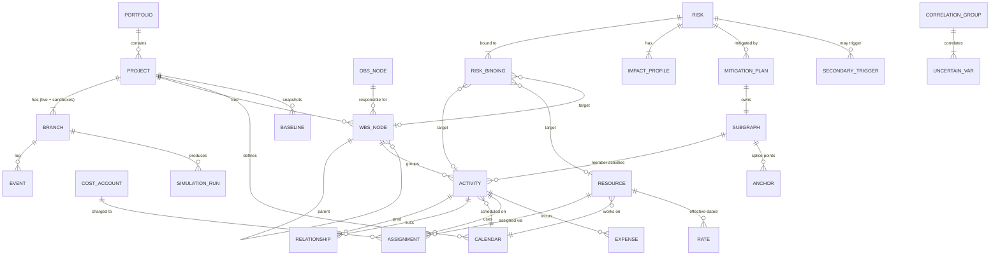

# SPEC-02 — Core Domain Ontology

Prev: [[01-Stack]] · Next: [[03-Pipeline]]

## 1. Entity-relationship overview

## 2. Entities (authoritative field list)
All IDs are `Uuid` newtypes (`ActivityId`, `RiskId`, …). The compiled model maps them to dense `u32`.

### 2.1 Structure
| Entity | Key fields | Rules |
|---|---|---|
| **Portfolio (EPS)** | id, name, parent | tree |
| **Project** | id, name, data_date: Instant, planned_start, must_finish_by?, default_calendar, settings | settings: `lag_calendar` (Predecessor\|Successor\|Project\|24h), `critical_def` (TotalFloat≤x \| LongestPath), `near_critical_threshold`, `progress_mode` (RetainedLogic\|ProgressOverride), `total_float_mode` (Start\|Finish\|Smallest) |
| **WbsNode** | id, parent?, code, name, obs?, sort_key | single rooted tree per project, codes unique among siblings |
| **ObsNode** | id, parent?, name, manager | tree |
| **CostAccount** | id, parent?, code | tree |

### 2.2 Time
| Entity | Key fields | Rules |
|---|---|---|
| **Calendar** | id, base?: CalendarId, week: [Vec<(start_min,end_min)>; 7], exceptions: BTreeMap<Date, Vec<interval>>, hours_per_day | inherits base week/exceptions; intervals inside a day are sorted and don't overlap; at least 1 working minute per 2-year window, otherwise invalid |

### 2.3 Network
| Entity | Key fields | Rules |
|---|---|---|
| **Activity** | id, code, name, wbs, kind, calendar, duration: `Estimate`, remaining?, constraints: (primary?, secondary?), actual_start?, actual_finish?, pct_complete, pct_type | kind ∈ TaskDependent, ResourceDependent, LevelOfEffort, StartMilestone, FinishMilestone, WbsSummary. Milestones have duration 0. Has actual_finish ⇒ completed |
| **Estimate** | `Deterministic(WorkMinutes)` \| `Triangular{o,m,p}` \| `Pert{o,m,p,λ=4}` \| `Uniform{min,max}` \| `Discrete[(v,p)]` | o ≤ m ≤ p; the deterministic value used by CPM = m (configurable: mean) |
| **Constraint** | kind, date | kinds: ASAP, ALAP, SNET, SNLT, FNET, FNLT, StartOn, FinishOn, MSO, MFO (hard). Secondary constraint allowed only with compatible primary (P6 rules) |
| **Relationship** | id, pred, succ, kind (FS/SS/FF/SF), lag: WorkMinutes (±), lag_calendar? | no self-links, no duplicate (pred,succ,kind), whole graph acyclic, LOE/WBS-summary activities not used as drivers |

### 2.4 Resources & cost
| Entity | Key fields | Rules |
|---|---|---|
| **Resource** | id, code, kind (Labor\|NonLabor\|Material), calendar, max_units: Vec<(effective_from, units_per_hour)>, rates: Vec<(effective_from, [Money;5])>, unit_of_measure (material) | max_units/rates sorted by date |
| **Assignment** | id, activity, resource, budget_units, units_per_hour, rate_type, cost_account?, curve (Uniform\|FrontLoaded\|BackLoaded\|Bell), actual_units, actual_cost, remaining_units | units = units/hr × duration (if resource-dependent, duration is derived from units) |
| **Expense** | id, activity, cost_account?, budget, actual, accrual (Start\|End\|Uniform) | |

### 2.5 Baselines & EVM
| Entity | Key fields | Rules |
|---|---|---|
| **Baseline** | id, name, branch_version (immutable state pointer), captured_at, time-phased budget cache | O(1) capture thanks to the persistent state. BAC = total budget at baseline |
| **ProgressSnapshot** | period_end, per-activity pct, actuals | basis for the EVM time series |

### 2.6 Risk physics
| Entity | Key fields | Rules |
|---|---|---|
| **Risk** | id, code, title, owner, kind (Threat\|Opportunity), status, pre: RiskState, post?: RiskState, bindings, proximity?, correlation_group?, secondary_triggers | status ∈ Potential, Active, Realized, Closed, Expired. A risk with `post` uses it whenever its preventive mitigation is `Accepted` |
| **RiskState** | probability ∈ [0,1], impacts: Vec<ImpactProfile> | |
| **ImpactProfile** | kind + distribution + application mode | `ScheduleDelay(Estimate)` adds working minutes to remaining duration; `DurationFactor(Estimate)` multiplies duration; `CostAdd(Estimate)`; `CostFactor(Estimate)`; `ResourceDegradation{resource?, factor, window}` cuts max units. Mode for branch/global bindings: `EachActivity` \| `Once` (applies to the single bound activity with the lowest total float; ties broken by code) |
| **RiskBinding** | target: Activity \| Resource \| WbsBranch(include_descendants) \| Global | Global schedule impacts apply to the project-finish milestone |
| **Proximity** | window_start, window_end | outside the window ⇒ cannot occur; once the data date passes window_end ⇒ auto-Expired |
| **SecondaryTrigger** | target_risk, conditional_probability | the trigger graph between risks must be acyclic (validated) |
| **MitigationPlan** | id, risk, kind (Preventive\|Contingent), status (Proposed\|Accepted\|Rejected\|Executed), subgraph, cost | **Preventive**: its activities are added to the live network when Accepted, and the risk switches to `post`. **Contingent**: the subgraph stays dormant and is spliced in only when the risk occurs (deterministically on Realize, or per iteration in Monte Carlo) |
| **Subgraph** | activities: Vec<Activity>, internal links, anchors: Vec<Anchor> | **Anchor** = link between a subgraph activity and a main-graph activity (kind, lag), plus optional `replaces: RelationshipId` (the dormant branch bypasses the original link when activated) |
| **CorrelationGroup** | members: Vec<UncertainVarRef>, matrix (Spearman) | symmetric, unit diagonal, entries in [-1,1]; repaired to the nearest PSD matrix with a warning |

### 2.7 Versioning & sandboxes
| Entity | Key fields | Rules |
|---|---|---|
| **Branch** | id, project, name, kind (Live\|Sandbox), parent?, fork_version, head_version, status (Open\|Merged\|Discarded\|Expired), created_by (Human(user)\|Agent(name)), ttl? | exactly one Live branch per project. Sandboxes are in-memory first and persisted on request or on merge |
| **Event** | branch, version (monotonic u64), command (typed enum), author, ts, touched: Vec<(EntityRef, Field)> | `touched` drives conflict detection |
| **SimulationRun** | id, branch, version, config (iterations, seed, mitigation_mode, outputs), result | result: finish/cost histograms, quantiles, CDF, joint confidence, criticality index, cruciality, tornado (inputs and risks), convergence trace |

## 3. Invariants (each becomes a property test)
1. Removing all constraints and progress ⇒ TF ≥ 0 for every activity, and at least one activity has TF = 0.
2. `ES ≤ LS` and `EF ≤ LF` whenever no hard constraint or must-finish-by target forces negative float.
3. For every active FS link: `succ.ES ≥ cal.add_work(pred.EF, lag)`, and likewise for SS/FF/SF.
4. fold(events of branch) == head state (event-sourcing determinism).
5. fork(b).state == b.state, and diff(fork, b) = ∅.
6. Merging a sandbox with no conflicts ⇒ live head == apply(sandbox events) on the live head at merge time.
7. MC with all distributions degenerate (o=m=p) and probabilities in {0,1} ⇒ every iteration equals the deterministic CPM.
8. Same seed ⇒ identical results for any rayon thread count.
